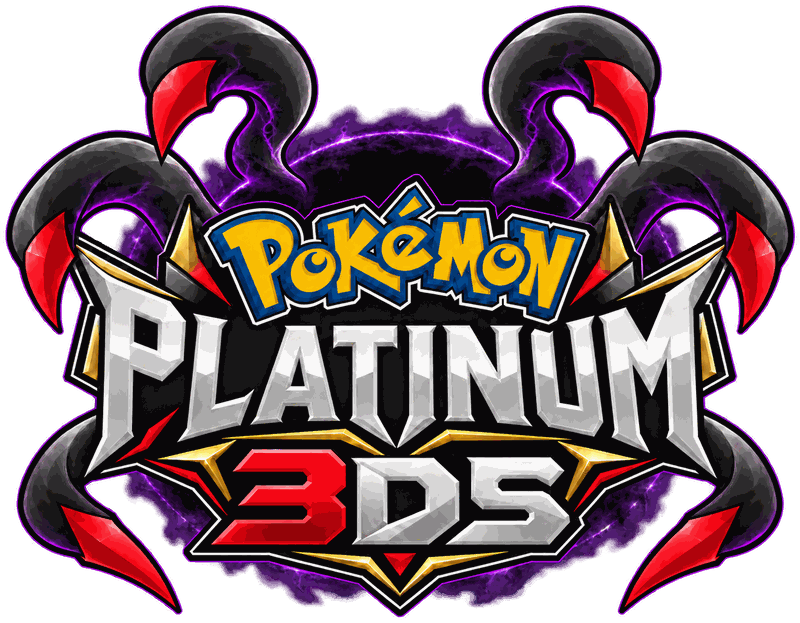

<p align="center">
  
</p>

<p align="center"><a href="README.md">English</a> · <b>Español</b></p>

# PokePlatinum-3DS

Un port nativo de Pokémon Platino para Nintendo 3DS, hecho para la New 3DS, a
partir de la decompilación [pret/pokeplatinum](https://github.com/pret/pokeplatinum).
No es un emulador ni un remake: el código del propio juego corre en la 3DS, y
el port lo dibuja como lo haría un juego de 3DS.

En una New 3DS:

- **Las dos pantallas llenas.** Las imágenes de la DS se dibujan 1,25 veces más
  grandes: la pantalla inferior llena sus 320×240, y la superior se reparte a lo
  largo de sus 400 píxeles de ancho (menús, cuadros de texto y combates
  incluidos). Nunca se estira ni se refleja nada para llenar el espacio extra.
- **3D más nítido.** El mundo y los combates los dibuja la GPU de la 3DS a la
  resolución de la propia pantalla, con bordes suavizados (antialiasing), la
  niebla del juego y una vista más amplia del mundo a los lados. (Los contornos
  de la DS alrededor del 3D vienen apagados; `edges on` en `remaster.txt` los
  dibuja.)
- **3D estereoscópico** con el deslizador 3D.
- **60 imágenes por segundo en el mapa.** El juego mueve el mapa a 30; el port
  dibuja una imagen intermedia entre cada par, y vuelve a 30 donde la GPU no da
  abasto (nuevo, todavía en ajuste).
- **Píxeles parejos y nítidos** en el 2D, y suavizado xBRZ opcional para las
  texturas del 3D.
- **Se instala en el menú HOME** (`.cia`), con el icono de tu cartucho.

En una 3DS antigua, muestra las dos pantallas de la DS en el centro de las de
la 3DS.

Platino es el **prototipo**. El objetivo a largo plazo es **Pokémon Plata
SoulSilver / Oro HeartGold**, cuando la decompilación
[pret/pokeheartgold](https://github.com/pret/pokeheartgold) esté lo bastante
avanzada. Los dos son juegos de la Generación 4 que comparten casi todo el motor.

## Estado

**Funciona**
- Jugable en consola real, desde una partida nueva o una guardada: explorar,
  combates, menús y guardar. Todavía tiene algunos errores visuales y de juego.
- Una interfaz nueva para la pantalla superior de la 3DS: menús, cuadros de
  texto y combates repartidos a lo largo de todo su ancho.
- Una resolución nueva para la New 3DS XL: las dos pantallas llenas al tamaño
  propio de la 3DS, con el 3D dibujado a la resolución de la pantalla.
- Animaciones actualizadas para la intro.
- Animaciones nuevas para parte de la interfaz.
- 60 imágenes por segundo
- Mejor calidad en el 3D

**En progreso**
- Una mejor interfaz para la pantalla inferior
- Un Pokémon que te sigue

**Lista de deseos**
- Wi-Fi
- Mejor iluminación

## Este repositorio no contiene nada del juego

Aquí y en las versiones publicadas no se guarda ninguna ROM, gráfico, música,
texto ni ningún otro dato del juego. El repositorio solo tiene:

- el código propio del port (`3ds_port/`),
- parches que se aplican sobre la decompilación y los SDK (`patches/`),
- herramientas que descargan la decompilación y compilan el port (`tools/`),
- el builder, que convierte **tu propio cartucho, volcado legalmente,** en los
  datos del juego, en tu propia computadora (`builder/`).

**Nunca se publican compilaciones del juego**, y no deberías compartir la tuya:
contienen el código del juego. La CI compila y prueba todo en cada push, pero
solo sube informes de texto y herramientas sin código del juego
(`tools/check_ci_artifacts.py` hace fallar la compilación si no es así).

Nunca subas al repositorio una ROM, un archivo extraído ni una compilación del
juego. El `.gitignore` bloquea los casos comunes, pero revisa `git status`
antes de hacer commit.

## Qué necesitas

- Una **consola de la familia 3DS** con custom firmware (Luma3DS) y el Homebrew
  Launcher (y **FBI** para la versión del menú HOME). Para la pantalla
  remasterizada hace falta una New 3DS, New 3DS XL o New 2DS XL. Guía para
  prepararla: <https://3ds.hacks.guide/es_ES/>
- Tu propio volcado de **Pokémon Platinum (USA)**, Rev 0 o Rev 1.
- [devkitPro](https://devkitpro.org/wiki/Getting_Started) con el grupo de
  paquetes `3ds-dev`, Python 3.10 o superior y Git.
- Opcional: el emulador [Azahar](https://azahar-emu.org) para probar en la PC.
  Corre la CPU de la 3DS más lento que una New 3DS real, así que juzga el
  rendimiento en la consola.

## Compilarlo y jugarlo

### En Windows

Descarga [`tools/build_windows_msys2.sh`](tools/build_windows_msys2.sh) y
ejecútalo en la terminal MSYS2 de devkitPro (menú Inicio → devkitPro → MSYS2).
Hace todo: instala lo que la compilación necesita aparte de devkitPro, clona
este repositorio, compila el juego (las dos versiones), crea tu paquete de
datos y deja los archivos de la tarjeta SD en `%USERPROFILE%\pokeplatinum-sd`
(y en la carpeta SD de Azahar, si la encuentra):

```sh
bash build_windows_msys2.sh 'C:\ruta\a\tu\platinum.nds'
```

Luego salta a [Copiar a la tarjeta SD](#copiar-a-la-tarjeta-sd).

### En Linux

Descarga [`tools/build_linux.sh`](tools/build_linux.sh) en tu carpeta personal
y ejecútalo. Igual que el de Windows, hace todo: instala devkitPro y el resto
de lo que la compilación necesita, clona este repositorio, compila el juego
(las dos versiones), crea tu paquete de datos y deja los archivos de la
tarjeta SD en `~/pokeplatinum-sd` (y en la carpeta SD de Azahar, si la
encuentra):

```sh
bash ~/build_linux.sh ~/ruta/a/tu/platinum.nds
```

En **Bazzite** y otros sistemas inmutables (Fedora Silverblue, Kinoite,
Aurora, Bluefin...), trabaja dentro de un distrobox que crea una sola vez
(`pokeplatinum-3ds`, a partir de la imagen oficial de devkitPro, la misma con
la que compila la CI), así que tu sistema no cambia; deja la ROM dentro de tu
carpeta personal. En **Ubuntu o Debian** corre directamente. Ejecútalo otra vez
para actualizar y volver a compilar.

Luego salta a [Copiar a la tarjeta SD](#copiar-a-la-tarjeta-sd).

### A mano (Linux o macOS)

1. **Descarga la decompilación y los SDK, y compila el juego:**

   ```sh
   python tools/bootstrap.py
   make game                                   # -> 3ds_port/game/build/3ds/pokeplatinum.3dsx
   make game-cia ROM=/ruta/a/platinum.nds      # -> .../pokeplatinum.cia (versión del menú HOME)
   ```

2. **Crea tu paquete de datos** a partir de tu propio volcado
   ([`builder/`](builder/README.md)):

   ```sh
   python builder/verify_rom.py /ruta/a/platinum.nds    # comprueba que es un volcado compatible
   python builder/extract_rom.py /ruta/a/platinum.nds   # -> data_pack/
   python builder/pack.py data_pack/                    # -> platinum3ds.pak
   ```

### Copiar a la tarjeta SD

```
sdmc:/3ds/pokeplatinum/platinum3ds.pak
sdmc:/3ds/pokeplatinum/manifest.json      (de data_pack/)
sdmc:/3ds/pokeplatinum.3dsx               (para el Homebrew Launcher)
sdmc:/cia/pokeplatinum.cia                (para el menú HOME, opcional)
```

En Azahar, van en la carpeta de su tarjeta SD emulada.

- **Homebrew Launcher:** abre `pokeplatinum.3dsx`, o ábrelo en Azahar.
- **Menú HOME:** en FBI, ve a **SD → cia → pokeplatinum.cia → Install CIA**.
  Después el juego se abre y se cierra desde el menú HOME como cualquier otro.
  Para actualizarlo, instala el `.cia` nuevo de la misma forma; tu partida se
  conserva.

El juego guarda en `sdmc:/3ds/pokeplatinum/platinum.sav`, un guardado de 512 KB
en bruto como los de los emuladores, así que puedes copiar ahí el guardado de
tu cartucho.

### Mientras juegas

Todos los botones son los del juego. El port escribe un registro en
`sdmc:/3ds/pokeplatinum/log.txt` (envíalo cuando reportes un problema); aparece
solo en pantalla si algo sale mal.

La pantalla tiene ajustes en `sdmc:/3ds/pokeplatinum/remaster.txt`; los valores
por defecto son los que casi todos quieren. Consulta
[`docs/REMASTER.md`](docs/REMASTER.md) (en inglés).

Donde la distribución del port para la pantalla más ancha no se vea bien,
puedes dibujar las franjas tú mismo con el editor **WideArt**: consulta
[`docs/WIDE_ART.md`](docs/WIDE_ART.md) (en inglés).

Hay más detalles (el ejecutable para PC, depurar cuelgues, el audio) en
[`3ds_port/game/README.md`](3ds_port/game/README.md) (en inglés).

## Cómo funciona

```
tu ROM ──► builder/ ──► platinum3ds.pak (se queda en tu computadora / tarjeta SD)

pret/pokeplatinum @ commit fijo ──► + patches/ ──► + 3ds_port/ ──► .3dsx / .cia
```

- El código C original del juego se compila con GCC para la CPU de la 3DS. La
  decompilación está fijada en [`upstream.lock`](upstream.lock); los cambios
  del port viven como archivos de parche, pequeños y fáciles de aplicar sobre
  una versión más nueva.
- Las bibliotecas de DS de Nintendo (NitroSDK y NitroSystem) también se
  compilan para la 3DS ([`3ds_port/nitro`](3ds_port/nitro),
  [`3ds_port/nitrosystem`](3ds_port/nitrosystem)). El hardware de DS con el
  que hablan lo pone el port: un renderizador 2D, un motor de geometría 3D que
  pasa las escenas a la GPU de la 3DS, un chip de sonido de DS por software y
  los servicios de la segunda CPU de la DS (chip de guardado, reloj, energía,
  pantalla táctil).
- El juego lee sus archivos de tu paquete de datos, por sus ID de archivo
  originales ([`docs/PAK_FORMAT.md`](docs/PAK_FORMAT.md)).
- El trabajo se reparte entre los núcleos de la New 3DS: el juego, el motor de
  geometría y el dibujo corren cada uno en el suyo.

## Desarrollo

```sh
python tools/bootstrap.py   # una vez: descarga la decompilación y los SDK, aplica los parches
make test                   # compila para la PC y corre todas las pruebas
make game                   # el juego para la 3DS
make game-cia ROM=...       # lo mismo, como .cia para el menú HOME
```

El mismo código del juego también compila como **`pokeplatinum-pc`**, un
ejecutable para PC sin pantalla, para ver rápido hasta dónde llega el juego y
dónde se detiene ([`3ds_port/game/README.md`](3ds_port/game/README.md)).

Para compilar la ROM original de DS a partir de la decompilación como
comprobación, sigue el [INSTALL.md](https://github.com/pret/pokeplatinum/blob/main/INSTALL.md)
de pret dentro de `build/upstream/`.

## Hoja de ruta

- **Hecho:** las herramientas de compilación; el código del juego compilado y
  corriendo en la 3DS; 2D, 3D, sonido, controles, guardado; el juego
  completamente jugable; la interfaz nueva de la pantalla superior; la
  resolución de la New 3DS XL; animaciones actualizadas de la intro y la
  interfaz; la versión del menú HOME.
- **En progreso:** 60 imágenes por segundo, mejor calidad en el 3D, una mejor
  interfaz para la pantalla inferior, mejor iluminación.
- **Lista de deseos:** Wi-Fi, un Pokémon que te sigue.
- **Más adelante:** SoulSilver / HeartGold sobre la misma base.

## Contribuir

Consulta [`CONTRIBUTING.md`](CONTRIBUTING.md) para ver cómo se hacen y prueban
los cambios, y [`AI_DISCLOSURE.md`](AI_DISCLOSURE.md) para ver cómo se usa la
ayuda de IA (los dos en inglés).

## Organización del repositorio

```
3ds_port/          código del lado de la 3DS
  game/            el juego: el programa de 3DS, el ejecutable para PC, la pantalla, el sonido, los controles
  nitro/           NitroSDK compilado con GCC, la capa de hardware de DS, pruebas unitarias en PC
  nitrosystem/     las bibliotecas Fnd/G2d/G3d/Gfd/Snd de NitroSystem y sus pruebas
  pak/             el lector del paquete de datos
  common.mk        opciones de compilación compartidas (host, host32 y devkitARM)
builder/           convierte tu propia ROM en el paquete de datos (Python)
docs/              la pantalla remasterizada, el arte ancho, el paquete de datos
patches/           cambios aplicados sobre la decompilación y los SDK
tools/             bootstrap, ayudas de compilación, el editor WideArt (Python)
Makefile           `make game`, `make game-cia`, `make test`, ...
LICENSE            GPL-3.0, para el código propio de este proyecto
upstream.lock      el commit exacto de pret/pokeplatinum sobre el que se compila
```

## Créditos y aspectos legales

El código original de este repositorio tiene licencia
[GNU General Public License v3.0](LICENSE). Eso cubre solo el código propio de
este proyecto, no el juego ni la decompilación.

Hecho sobre el trabajo de los equipos de decompilación de
[pret](https://pret.github.io/), e inspirado por
[pokeemerald-3Ds-dualscreen](https://github.com/ZallaxDev/pokeemerald-3Ds-dualscreen).
Consulta [`NOTICE.md`](NOTICE.md).

Este es un proyecto no oficial hecho por fans, sin relación con Nintendo, Game
Freak, Creatures ni The Pokémon Company, ni respaldado por ellos. Pokémon es una
marca registrada de sus respectivos dueños.

> Esta traducción sigue al [README en inglés](README.md); si algo no coincide,
> manda el inglés.
